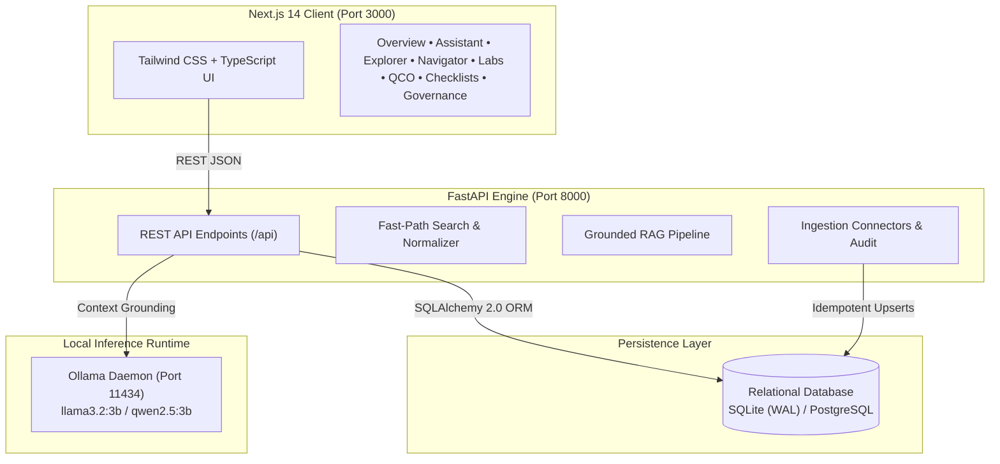

# BIS AI Copilot — Bureau of Indian Standards Intelligence & Compliance Platform

**BIS AI Copilot** is an enterprise-grade digital platform engineered for manufacturers, importers, laboratories, engineering teams, and quality assurance professionals navigating the regulatory landscape of the **Bureau of Indian Standards (BIS)**.

The platform grounds natural-language inquiries into verified Indian Standards (IS), mandatory Quality Control Orders (QCO), accredited laboratory directories, and conformity assessment schemes with complete provenance tracking and zero per-request token costs.

---

## 1. System Architecture



---

## 2. Core Functional Modules

1. **Overview Dashboard**: Real-time database metrics (verified standards, active QCOs, testing laboratories, and schemes), global search entry, and quick workflow launchpads.
2. **AI Compliance Assistant (`/assistant`)**: Multi-turn conversational research assistant grounded in database records. Features citation pills with official BIS URLs, fast-path vs local model latency indicators, copy answer, and chat reset.
3. **Standard Explorer (`/standards`)**: Intelligent search with Indian Standard number normalization (`IS 302`, `is302`, `302:2008`), division filters (ETD, CED, MED, LITD, FAD, MTD), mandatory QCO badges, scope abstracts, and laboratory counts.
4. **Certification Navigator (`/navigator`)**: Guided 6-step product compliance audit. Evaluates product applications, identifies Indian Standards, validates mandatory QCO decrees, determines scheme classification (Scheme-I ISI Mark vs Scheme-II CRS), locates testing facilities, and generates compliance checklists in 1 click.
5. **Testing Laboratories Directory (`/laboratories`)**: Comprehensive directory of BIS Central, Regional, and recognized partner labs. Filter by State, City, or Standard number, with distance calculation (Haversine formula) and test scope details.
6. **QCO Explorer (`/qco`)**: Quality Control Order tracker with issuing ministry filters (DPIIT, MeitY, Ministry of Steel, MoRTH, MNRE), gazette publication dates, enforcement deadlines, and amendment change histories.
7. **Checklist Maker & Project Tracker (`/checklists`)**: Persistent project tracking. Create compliance audits, add/edit/delete/reorder tasks, toggle completion states, track progress percentage, export formatted audit sheets to CSV, and access print-ready views.
8. **Official Sources & Provenance (`/sources`)**: Directory of official Government of India portals (Know Your Standard, BIS LIMS, e-BIS Manakonline, e-Gazette), update frequencies, and legal reuse parameters.
9. **Data Coverage & Governance (`/coverage`)**: Administrative data-quality view distinguishing verified official records from fixtures, tracking ingestion batch runs, and documenting legal boundaries (e.g. copyrighted full-text standards sold exclusively by BIS).
10. **Settings & AI Diagnostics (`/settings`)**: Live reachability testing for the local Ollama inference runtime, model selection instructions, database health stats, and fast-path fallback monitors.

---

## 3. Technology Stack

- **Frontend**: Next.js 14+ (App Router), React 18, TypeScript, Tailwind CSS, Lucide Icons.
- **Backend**: Python 3.12, FastAPI, Pydantic v2, SQLAlchemy 2.0, Uvicorn, httpx, aiofiles.
- **Database**: SQLite (default zero-dependency development with WAL mode & foreign key PRAGMA) / PostgreSQL (production configuration ready).
- **AI Inference**: Ollama local open-weight models (`llama3.2:3b`, `qwen2.5:3b`, `phi3:mini`) with resilient deterministic fast-path fallback when offline.
- **Automated Testing**: pytest, pytest-asyncio, FastAPI TestClient.

---

## 4. Quickstart Guide (Local Development)

### Prerequisites
- Python 3.12+
- Node.js 18+ and npm
- Ollama (Optional, for local AI inference)

### Step 1: Clone and Configure Backend
```bash
# Navigate to project root
cd "bis copilot"

# Activate virtual environment (or create with python -m venv backend/venv)
backend\venv\Scripts\activate   # Windows
# source backend/venv/bin/activate  # macOS / Linux

# Install backend dependencies
pip install -r backend/requirements.txt

# Run initial seed ingestion across official BIS datasets
python -m backend.app.ingestion.runner

# Launch FastAPI backend service
uvicorn backend.app.main:app --host 127.0.0.1 --port 8000 --reload
```
*The backend API documentation is now live at: `http://127.0.0.1:8000/docs`.*

### Step 2: Launch Next.js Frontend
In a separate terminal:
```bash
cd frontend

# Install npm packages
npm install

# Run Next.js development server
npm run dev
```
*The web platform is now accessible at: `http://localhost:3000`.*

---

## 5. Local AI Model Setup (Ollama)

To enable deep open-weight inference locally without cloud API charges:

1. **Install Ollama**: Download from [ollama.com](https://ollama.com).
2. **Download Model**:
   ```bash
   ollama pull llama3.2:3b
   ```
3. **Start Ollama Service**:
   ```bash
   ollama serve
   ```
4. **Enable in Backend**:
   Set `OLLAMA_ENABLED=true` in `backend/.env` or environment variables.

> [!NOTE]
> When Ollama is offline or warming up, the platform operates in **Deterministic Fast-Path Mode**. Queries are grounded directly in database records and return verified citations with 0 ms AI latency.

---

## 6. Docker Deployment

Deploy the entire stack with Docker Compose:

```bash
docker-compose up --build -d
```

Services started:
- `backend`: FastAPI server listening on `http://localhost:8000`
- `frontend`: Next.js web application listening on `http://localhost:3000`

---

## 7. Automated Testing & Verification

Run the test suite:

```bash
backend\venv\Scripts\pytest.exe -v
```

### Test Suite Coverage:
- `test_root_endpoint`: Verifies service startup, metadata, and operational status.
- `test_health_endpoint`: Tests database connection and AI engine diagnostics.
- `test_standards_search_and_exact_lookup`: Validates query normalization, division filtering, and QCO cross-referencing.
- `test_qco_search_and_details`: Tests ministry filtering and amendment history linking.
- `test_laboratories_directory`: Validates geographic distance calculation (Haversine formula) and standard scope matching.
- `test_checklist_crud_and_csv_export`: Validates task additions, completion metrics, and RFC 4180 CSV export.
- `test_ai_navigator_workflow`: Verifies 6-step certification audit synthesis and scheme selection.
- `test_ai_chat_pipeline`: Verifies conversational multi-turn RAG retrieval and citation grounding.
- `test_coverage_dashboard`: Validates data governance metrics and verified record counts.

---

## 8. Data Governance & Licensing Notice

1. **Non-Official Advisory**: BIS AI Copilot is an independent compliance assistance tool and is not affiliated with or endorsed by the Bureau of Indian Standards or Government of India ministries.
2. **Copyright Protection**: In compliance with Indian copyright laws, this platform **does not distribute copyrighted full-text standards**. It indexes permitted public abstracts, titles, scopes, gazette QCOs, and directs users to official portals (`manakonline.in`, `bis.gov.in`) for statutory purchases and application filings.
